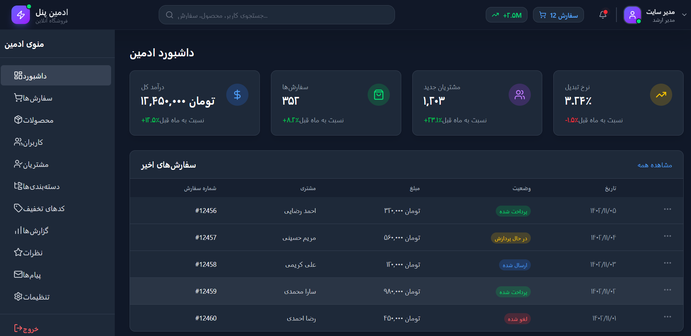
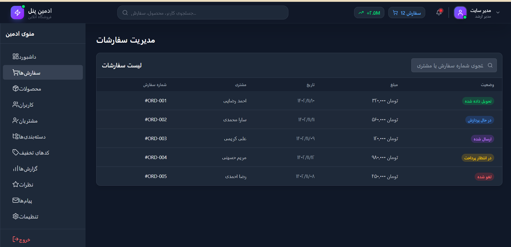
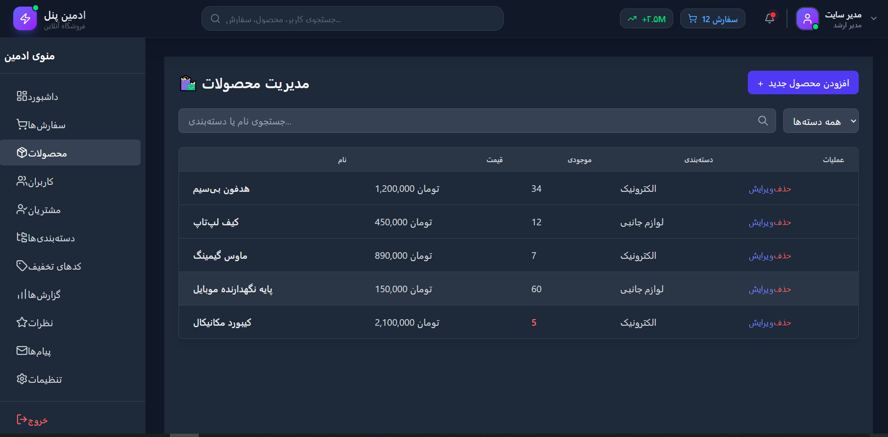
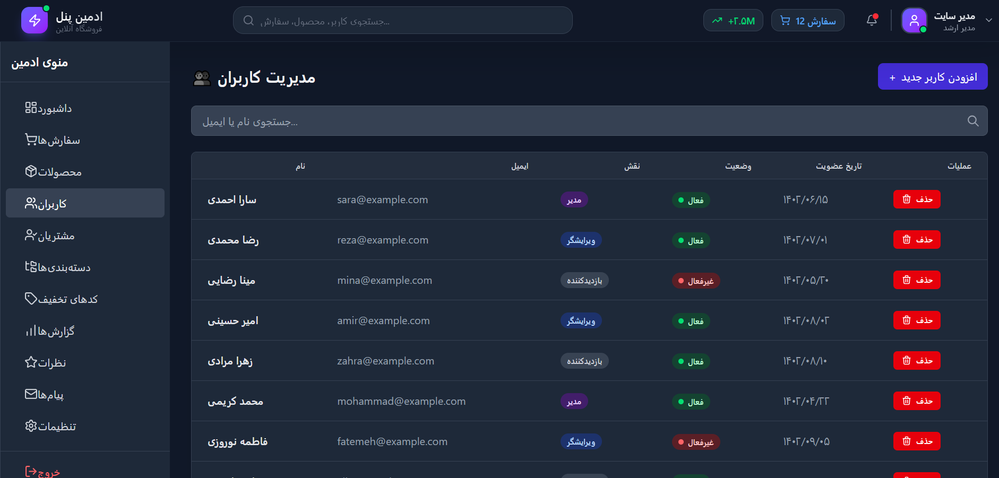

<div align="center">

# 📊 Admin Dashboard

### داشبورد مدیریت مدرن با React + TypeScript

یک پنل ادمین کامل، سریع و زیبا برای مدیریت پروژه‌های وب

[](https://react.dev)
[](https://www.typescriptlang.org)
[](https://vitejs.dev)
[](https://tailwindcss.com)

[مشاهده‌ی دمو](https://admin-dash-react-ylvr.vercel.app/) · [گزارش باگ](https://github.com/MobinDe/Admin-Dash-React/issues) · [درخواست فیچر](https://github.com/MobinDe/Admin-Dash-React/issues)

</div>

---

## 📸 پیش‌نمایش صفحات

<div align="center">

### 🏠 داشبورد اصلی


<br/>
<br/>

<table>
<tr>
<td align="center" width="50%">

### 🛒 مدیریت سفارشات


</td>
<td align="center" width="50%">

### 📦 مدیریت محصولات


</td>
</tr>
<tr>
<td align="center" colspan="2">

### 👥 مدیریت کاربران


</td>
</tr>
</table>

</div>

---

## ✨ امکانات کلیدی

<table>
<tr>
<td width="50%">

### 📊 داشبورد آماری
- چارت‌ها و نمودارهای تعاملی
- آمار لحظه‌ای فروش و کاربران
- کارت‌های KPI با انیمیشن
- فیلتر بازه‌ی زمانی

### 👥 مدیریت کاربران
- CRUD کامل کاربران
- جستجو و فیلتر پیشرفته
- صفحه‌بندی هوشمند
- نقش‌ها و دسترسی‌ها

### 📦 مدیریت محصولات
- جدول پیشرفته با Sort
- آپلود تصویر
- دسته‌بندی داینامیک
- مدیریت موجودی انبار

</td>
<td width="50%">

### 🛒 مدیریت سفارشات
- پیگیری وضعیت سفارش
- تغییر وضعیت با یک کلیک
- تاریخچه‌ی کامل سفارش
- Export به Excel و PDF

### 🎨 طراحی مدرن
- حالت Dark/Light
- انیمیشن‌های نرم
- کاملاً ریسپانسیو
- RTL کامل فارسی

### 🔒 امنیت
- احراز هویت JWT
- Protected Routes
- مدیریت Session
- اعتبارسنجی فرم‌ها

</td>
</tr>
</table>

---

## 🛠 تکنولوژی‌های استفاده شده

### Frontend
| تکنولوژی | نسخه | کاربرد |
|:---:|:---:|:---|
|  | 18 | کتابخانه‌ی UI |
|  | 5 | Type Safety |
|  | 6 | Build Tool |
|  | 3 | استایل‌دهی |
|  | 6 | مسیریابی |

### کتابخانه‌های اصلی
- **Recharts** — نمودارها و چارت‌های تعاملی
- **React Hook Form + Zod** — فرم‌ها و اعتبارسنجی
- **TanStack Query** — مدیریت State سرور
- **React Icons** — آیکون‌های حرفه‌ای
- **Axios** — ارتباط با API

---

## 🚀 نصب و راه‌اندازی

### پیش‌نیازها
- Node.js **18+**
- npm یا yarn

### مراحل نصب

```bash
# ۱. کلون پروژه
git clone https://github.com/MobinDe/Admin-Dash-React.git

# ۲. ورود به پوشه
cd Admin-Dash-React

# ۳. نصب وابستگی‌ها
npm install

# ۴. اجرای dev server
npm run dev